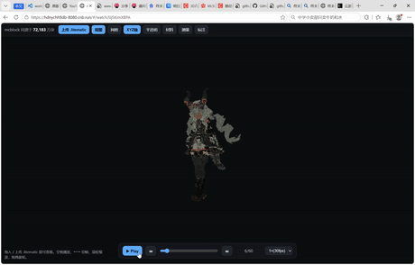

# mc-voxel-video

把 MMD 舞蹈转成真实 Minecraft 方块逐帧模型，纯网页 24fps 播放。
Turn an MMD dance into a figure built from REAL Minecraft blocks, played back at 24fps in a web page。

---

## 中文

一句话：给一段 动作 (.vmd) + 一个 角色模型 (.pmx)，自动产出用真实 MC 方块搭出来的逐帧模型，并在纯前端网页里 24fps 播放。不进真实 MC 世界，交付物是一个网页播放器。
### 角色
当前示例角色：提弗洛斯 (Typhoea)，MMD 模型在 player/mmd-direct/models/提弗洛斯.pmx。

### 输入只需要两样东西
- 动作：任意 .vmd（下载的、自己 K 的都行），用 --vmd 指定。
- 人物模型：任意 .pmx，用 --pmx 指定。
模型 / 动作都不写死，换文件只改 STAGE 1 的两个参数即可。
资源出处（用户提供的）：
- 动作 daybyday（XII-Ram 配布，B 站演示）：https://www.bilibili.com/video/BV1RHn86wEf1/
- 动作 daybyday 下载（aplaybox）：https://aplaybox.com/details/motion/AnFKX3dRbPLq
- 角色模型 提弗洛斯（茶叶味香皂，明日方舟：终末地）：https://www.aplaybox.com/details/model/mDl26SNpxlus

注：终末地原版是游戏模型，需先转成 MMD 的 .pmx 才能喂给本流水线；仓库里的 提弗洛斯.pmx 已经是一个可用的 MMD 版。
### 流水线（3 个阶段）
```
MMD (.pmx + .vmd)
   STAGE 1  pipeline/sample_mmd.py   (Blender 烘焙逐帧 GLB)
逐帧 GLB
   STAGE 2  体素化 (ObjToSchematic / 或 pipeline/b_anchor.py 时间相干方案)
MC 方块 litematic
   STAGE 3  player/build.mjs         (解析 litematic -> frames.json)
网页数据 player/data/frames.json + player/assets/block-textures/*.png
   player/index.html                 (THREE.js 渲染, 24fps 切帧)
浏览器播放
```
完整文档（含所有文件路径、命令、已知问题）：[docs/USAGE.md](docs/USAGE.md)。
### 网页播放器
- player/index.html：three.js InstancedMesh 体素播放器（自带 player/data/frames.json 演示数据 + player/assets/block-textures/ 73 张方块贴图）。
- player/mmd-direct/index.html：直接读取 MMD 的网页播放器（含 Endfield 风格 GLSL 近似渲染）。支持 ?model=PMX路径 与 ?vmd=VMD路径 直接加载任意模型/动作。
- player/shulkr-replica/：shulkr 风复刻查看器。

本地预览：
```bash
cd player && python3 -m http.server 8123
# 打开 http://localhost:8123/          (体素)
#      http://localhost:8123/mmd-direct/  (MMD，可加 ?model=Norma/诺姆1.pmx)
```
CNB 预览规律：本地端口 X 对应 https://你的会话前缀-X.cnb.run/player/index.html
### 已知问题：电视雪花 / 马赛克
下面 GIF 是 错误示范 —— STAGE 2 没加 VOX=solid 时的表面体素化散云（手臂穿过身体时一条射线打到多层表面，每帧被撒成内部切片，像电视无信号雪花）。正确做法见 USAGE.md 第 4、7 节。



重要更正：录屏里真正的毛病是 时空前后抖动（帧间抖），不是雪花。抖动是时间相干性问题，VOX=solid 只修雪花、修不了抖动；治抖动用 pipeline/b_anchor.py（方案 B：每个三角形固定方块类型，三角形随身体平移，颜色闪烁/抖动归零，且不需要 ObjToSchematic）。
### 目录结构
- pipeline/：STAGE1 bake、STAGE2 b_anchor 体素器、stabilize 等脚本
- player/：体素播放器 + mmd-direct + shulkr-replica + data/frames.json + assets/block-textures
- docs/：USAGE.md 完整文档 + voxel_snow_demo.gif
- 其它工作目录（frames_glb/ frames_ots*/ tools/ downloads/ 等）为本地生成 / 缓存，已随仓库一并提交（详见提交记录）

---

## English

One-liner: give a motion (.vmd) + a character model (.pmx), and it automatically produces a per-frame model built from real Minecraft blocks, played back at 24fps in a pure front-end web page. No live Minecraft world - the deliverable is a web player。

### Character
Current sample character: Typhoea, MMD model at player/mmd-direct/models/提弗洛斯.pmx。

### Input: just two things
- Motion: any .vmd (downloaded or hand-keyed), passed via --vmd。
- Character model: any .pmx, passed via --pmx。
Neither is hard-coded; swap files by changing just the two STAGE 1 arguments。
Resource links (provided by the user):
- Motion daybyday (XII-Ram distribution, Bilibili demo): https://www.bilibili.com/video/BV1RHn86wEf1/
- Motion daybyday download (aplaybox): https://aplaybox.com/details/motion/AnFKX3dRbPLq
- Character model Typhoea (茶叶味香皂, Arknights: Endfield): https://www.aplaybox.com/details/model/mDl26SNpxlus

Note: the original Endfield asset is a game model; it must be converted to an MMD .pmx before feeding this pipeline. The repo 提弗洛斯.pmx is already a usable MMD version。
### Pipeline (3 stages)
```
MMD (.pmx + .vmd)
   STAGE 1  pipeline/sample_mmd.py   (Blender bakes per-frame GLB)
per-frame GLB
   STAGE 2  voxelize (ObjToSchematic / or pipeline/b_anchor.py temporal-coherence)
MC block litematic
   STAGE 3  player/build.mjs         (parse litematic -> frames.json)
web data player/data/frames.json + player/assets/block-textures/*.png
   player/index.html                 (THREE.js render, 24fps frame swap)
browser playback
```
Full documentation (paths, commands, known issues): [docs/USAGE.md](docs/USAGE.md)。
### Web players
- player/index.html: three.js InstancedMesh voxel player (ships player/data/frames.json demo data + player/assets/block-textures/, 73 block textures)。
- player/mmd-direct/index.html: direct MMD web player (Endfield-style GLSL approximation). Supports ?model=PMX-PATH and ?vmd=VMD-PATH to load any model / motion directly。
- player/shulkr-replica/: shulkr-style replica viewer。

Local preview:
```bash
cd player && python3 -m http.server 8123
# open http://localhost:8123/           (voxel)
#      http://localhost:8123/mmd-direct/  (MMD; add ?model=Norma/诺姆1.pmx)
```
CNB preview: local port X maps to https://YOUR-PREFIX-X.cnb.run/player/index.html
### Known issue: TV snow / mosaic
The GIF below is a bad example - the surface voxelizer (without VOX=solid) at STAGE 2 scatters the figure into internal slices (like TV static) when limbs intersect the body. The correct approach is in USAGE.md section 4 and 7。


Important correction: the real problem in the recording is temporal jitter (frame-to-frame shaking), not snow. Jitter is a temporal-coherence issue; VOX=solid fixes snow but not jitter. Fix jitter with pipeline/b_anchor.py (Option B: each triangle gets one fixed block type, triangles merely translate, color flicker/jitter drops to zero, and ObjToSchematic is not needed)。

### Directory layout
- pipeline/: STAGE1 bake, STAGE2 b_anchor voxelizer, stabilize scripts
- player/: voxel player + mmd-direct + shulkr-replica + data/frames.json + assets/block-textures
- docs/: USAGE.md full docs + voxel_snow_demo.gif
- Other working dirs (frames_glb/ frames_ots*/ tools/ downloads/ etc.) are local generated / cached data, committed alongside the source (see commit history)
